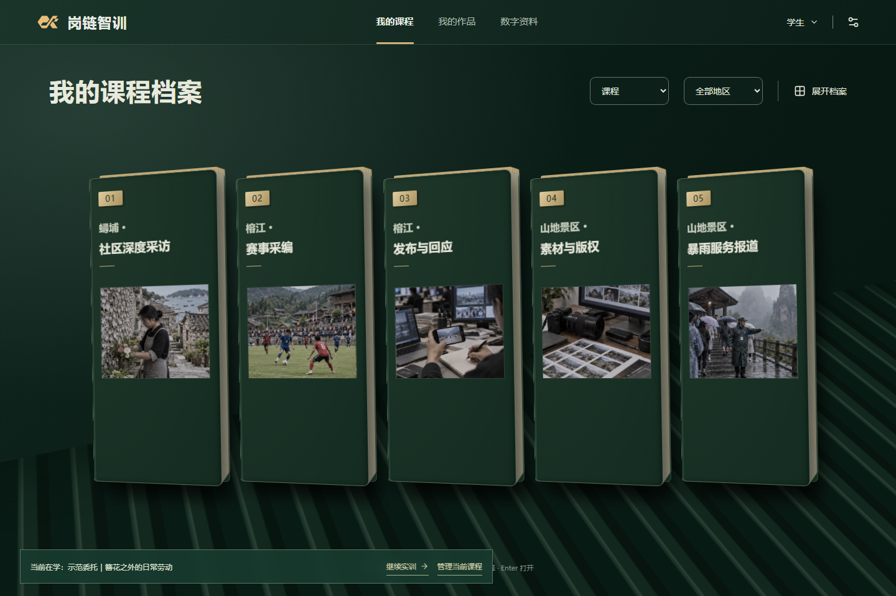

# 岗链智训

**面向职业教育高水平专业群建设的融媒体内容生产与治理岗位群教学实训智能体平台。**

学生以记者身份接收岗位委托，在仿真场景中调查、采访、核验资料并交付作品；教师配置课程与人物，结合实际作品和过程证据进行复核，再决定后续训练。项目服务于 2026 中国青年科技创新“揭榜挂帅”擂台赛 XA-202603 榜题。历史名称为“融岗智训”，包名和启动脚本继续沿用 `ronggang`。

本仓库是完整开发工作区。当前产品基线为 **V3.0.1**；包含后续登录、公开导览和部署修订，具体提交与验证范围见[开发历史](doc/03-开发历史.md)。参赛提交包、静态导览和完整应用各有自己的交付范围。

[项目总纲](doc/00-项目总纲.md) · [开发者文档](doc/01-开发者文档.md) · [当前规划](doc/02-项目规划.md) · [资料索引](资料/资料索引.md) · [部署说明](deploy/README.md)

## 产品流程


- **学生端**：课程档案、三地区场景、人物交流、私人采访本、作品修订与评价回看。
- **教师端**：班级学生档案、课程导演、人物与工作流配置、资料导入、作品评阅。
- **后端内核**：受约束的模型候选、权威世界状态、内容授权、过程证据与恢复。当前主界面的管理员入口已禁用，内部审计和恢复能力仍保留。

现有五门课程覆盖社区采访、赛事采编、发布回应、素材版权和暴雨服务报道，分布于蟳埔、榕江、青岚三地区。课程、人物、事件和当日平台数字属于教学仿真；专业标准与公开原件另有[来源记录](资料/04-职业教育依据/07-V3三地区五课程资料来源.md)。



## 本地运行

推荐 **Node.js 24.20.0 或更新的 24.x**、**pnpm 11.9.0**，版本约束见 [package.json](package.json)。命令均在仓库根目录执行。缺少 Corepack 时先执行 `npm install -g corepack`。

```sh
corepack enable
corepack pnpm install --frozen-lockfile
corepack pnpm start
```

`corepack enable`用于首次建立包管理器代理。若提示pnpm版本不一致，在仓库根目录核对`pnpm --version`与`corepack pnpm --version`均为11.9.0，检查终端PATH中是否有其他pnpm覆盖代理。

Windows 也可双击 [启动融岗智训.cmd](启动融岗智训.cmd)。首次启动会构建共享包、API 和网页；保持终端打开，等待入口地址输出。

| 项目 | 默认值 |
| --- | --- |
| 完整网页 | <http://127.0.0.1:4173/> |
| API / 健康检查 | <http://127.0.0.1:3001/health> |
| 持久数据 | `.local/data/` |
| 开发模式网页 | `corepack pnpm dev`，默认端口 5173 |

在终端输入 `stop` 回车，或按 Ctrl+C 正常停止。`corepack pnpm start:fresh` 会另建空白体验目录，原数据保留。不要同时运行两个写入同一数据目录的服务。

### 演示账号

首页提供学生／教师档案入口，演示密码均为 **`Demo2026`**。这些凭据在登录页公开显示。

| 账号 | 身份 |
| --- | --- |
| `teacher` | 演示教师，管理 A、B 两班 |
| `student1` | 学生 1，A 班 |
| `student2` | 学生 2，A 班 |
| `student3` | 学生 3，B 班 |

启动时幂等初始化两班各 10 名测试学生，其余 17 人仅有名册，不生成成绩。三个可登录学生的课程、作品和私人笔记分别保存。

### 建议体验顺序

1. 学生选择课程，阅读委托，通过地图出口、人物和资料开展调查；场景支持拖动与缩放。
2. 在“采访本”保存私人笔记，在“工作台”保存作品后锁定送审；可自行选择附交笔记副本或纸质笔记照片。
3. 切换教师，选择班级与学生，查看实际提交的作品并逐维评阅。
4. 在“课程导演”配置人物、知识、关系和工作流，发布后由学生新开课程体验；已有课程使用开课时的发布版本。

一名学生同时只有一门在学课程。换课放弃需再次确认，原作品与历史保留。教师无法读取未主动提交的私人笔记。

## 模型与可选能力

未提供私有配置时，默认使用 `deterministic` 规则模式与讯飞 `mock`，可运行本地业务流程；这不代表在线模型、语音或 OCR 已可用。

需要真实模型时，将 [.env.example](.env.example) 复制为未被 Git 跟踪的 `.env.local`，在服务端填写自己的凭据并重启。以下为配置字段，密钥值留空：

```dotenv
MODEL_PROVIDER=deepseek
DEEPSEEK_BASE_URL=https://api.deepseek.com
DEEPSEEK_MODEL=deepseek-flash
DEEPSEEK_API_KEY=
SHOWCASE_DETERMINISTIC_STRUCTURED=0
```

模型名称和接口需与自己的服务账号匹配。视觉能力单独配置；不根据文字模型名称推断图片支持。密钥只存放在服务端环境中，不随源码、网页或镜像分发。其他参数及讯飞适配入口见[模型配置](packages/model-gateway/src/config.ts)和[开发者文档](doc/01-开发者文档.md#9-数据模型与恢复)。

PDF 识别、语音处理与本地语义向量检索使用额外的 Python 3.11 环境、ffmpeg 和相应模型。Windows 可在 PowerShell 7 中按需准备：

```powershell
./scripts/setup-ai025-runtime.ps1
./scripts/setup-be007-runtime.ps1
```

准备运行环境并启动服务后，可另开终端执行 `corepack pnpm content:prepare`，将四份公开专业 PDF 按课程授权导入并建立五课索引。来源位于[职业教育依据](资料/04-职业教育依据/)，准备回执位于 `.local/content-preparation/receipt.json`。原始 PDF 是运行输入，应与整理性笔记分别维护。

## 工程结构

采用 pnpm workspace，正式运行范围只有 `apps/*` 与 `packages/*`。

```text
apps/
  web/                  React + Vite：师生页面、静态导览与运行美术素材
  api/                  Fastify：身份、课程、世界、作品、评价与恢复
packages/               12 个共享包，见下表
scripts/                启动、资料准备、验证、发布与数据维护工具
e2e/                    Playwright 真实流程回归
deploy/                 Docker、Nginx 和部署说明
.github/workflows/      静态导览发布与 Linux 镜像构建
doc/                    00 总纲、01 当前实现、02 规划、03 历史及专题说明
资料/                   外部依据、历史研究与视觉参考
前端设计/               设计提案与独立样机，不参与正式工作区构建
演示/                   按版本保存的操作手册、截图与演示工程
artifacts/              被程序读取的赛事矩阵、验证样本与历史证据
.local/                 本机数据、模型环境、生成产物及发布副本，Git 忽略
参赛材料工作区/          本机参赛材料与签署文件，Git 忽略
```

| 共享包 | 职责 |
| --- | --- |
| `contracts`、`course-content`、`scenario-catalog` | 公共契约、课程内容与场景目录 |
| `world-core`、`agent-runtime`、`agent-orchestrator` | 权威状态、智能体运行与任务编排 |
| `model-gateway`、`iflytek-adapter` | 模型与讯飞供应方适配 |
| `content-store`、`context-engine` | 内容持久化、授权检索与上下文组装 |
| `session-control`、`media-processing` | 组织与场次控制、资料摄入及媒体处理 |

前端展示、模型候选和权威状态写入分层；模型无法凭自然语言直接授权、改变世界或产生有效成绩。数据边界和实现入口见[开发者文档](doc/01-开发者文档.md)，历史 V3/V4 名称表示契约代际。

## 资料与文档维护

[资料索引](资料/资料索引.md)负责外部依据的采用结论；产品目标与任务只在[项目规划](doc/02-项目规划.md)维护。

- `资料/01—04`：赛事原题映射、专业特色、技术路线及职业教育依据；新增资料应写明来源、采用范围与落点。
- `资料/90-历史资料归档`：旧方案、旧调研、审查稿和历史决策摘要，不作为当前需求或实现状态。
- `资料/91-视觉与演示资产`：概念、用户参考图和历史演示工程；图片存在不等于功能验收通过。
- `前端设计/` 与 `演示/`：保留各自版本与状态；正式程序以 `apps/web` 为准，早期截图不作为当前运行证明。
- `artifacts/`：其中部分 JSON 是 API 的固定输入，不能整体当作临时输出删除。

完整对话转储退出当前目录，源码与材料变更通过 Git 追溯。本机学习数据、密钥、模型缓存、原始录制和大型渲染产物按忽略规则管理；整理时不要把它们加入源码提交。

## 验证与维护

```sh
corepack pnpm check:versions     # 15 个运行包及产品版本
corepack pnpm check:docs         # 主文档、任务和本地链接
corepack pnpm check:secrets      # 可发布源码的密钥形状检查
corepack pnpm typecheck          # 共享包构建及全工作区类型检查
corepack pnpm test               # 共享包、API、Web 测试
corepack pnpm build              # 完整生产构建
corepack pnpm start:smoke        # 隔离数据的启动与关闭检查
corepack pnpm test:e2e           # 构建后执行浏览器流程
```

首次浏览器回归可先执行 `corepack pnpm browser:install`。完整常规检查为 `corepack pnpm check`；Live 模型检查需要单独凭据和授权运行。测试与部署的实际通过范围记录在[开发历史](doc/03-开发历史.md)，命令列出不代表已经执行。

数据备份、核验和恢复分别使用 `data:backup`、`data:verify`、`data:restore`；先构建 API，再按[数据安全 CLI](apps/api/src/data-safety-cli.ts)的 `--help` 提供参数。出现目录占用时先确认旧服务正常停止，不直接删除锁文件或重置学习数据。

## 发布与当前限制

源码仓库为 [falling-feather/ganglian-zhixun](https://github.com/falling-feather/ganglian-zhixun)。[GitHub Pages](https://falling-feather.github.io/ganglian-zhixun/) 与 [Sites](https://ganglian-student.fallensigh0901.chatgpt.site)提供静态学生导览，使用预设访谈、本机笔记与草稿，不调用模型、不提供教师评分或云端提交。

完整应用的阿里云地址与部署配置见[部署说明](deploy/README.md#阿里云完整系统)。该说明记录了 2026-09-15 的 HTTPS、登录、课程及资料索引检查，也明确保留在线模型超时和完整送审尚未完成线上验收的结论；不能用静态站点或规则回复替代在线模型能力证明。

当前适合本机与单实例演示。真人学习时长、真实职教师生反馈、外部专家效度、学校并发容量、生产 SSO 与完整多租户尚未得到完整验证。固定样例、自动化测试和模型评价分别说明其证据范围。

仓库尚未声明开源许可证。公开可访问不代表代码、参考材料和第三方素材已获得任意再分发授权。
